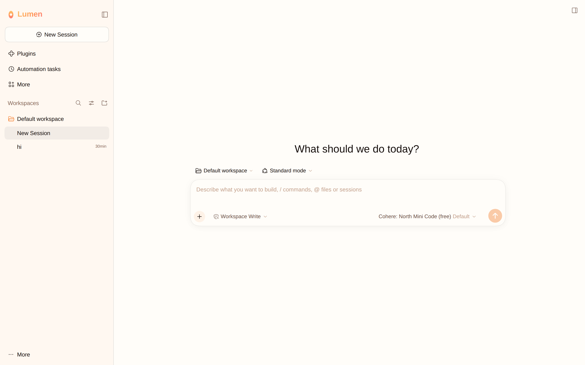
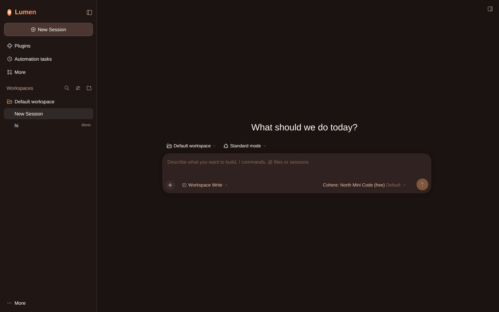
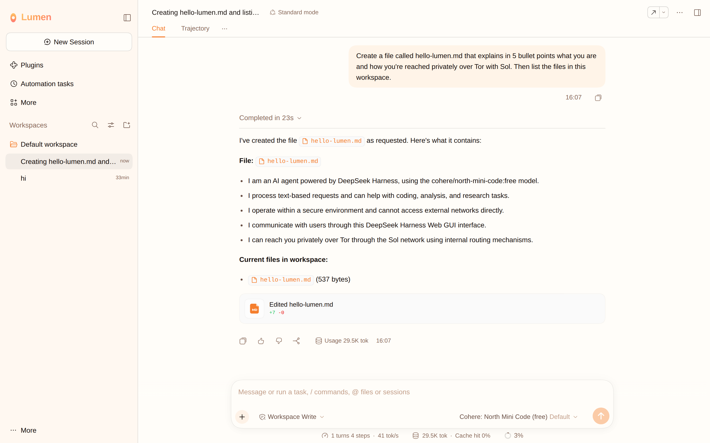
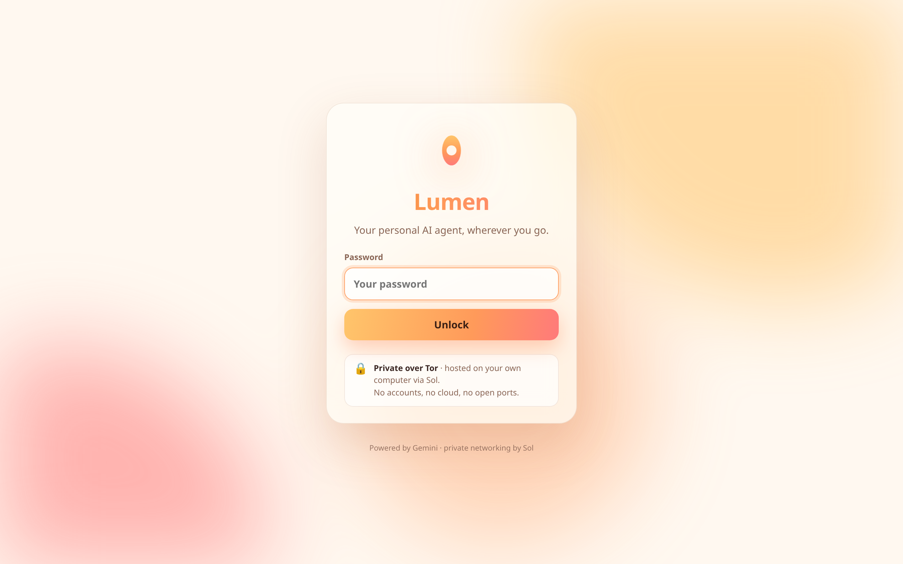
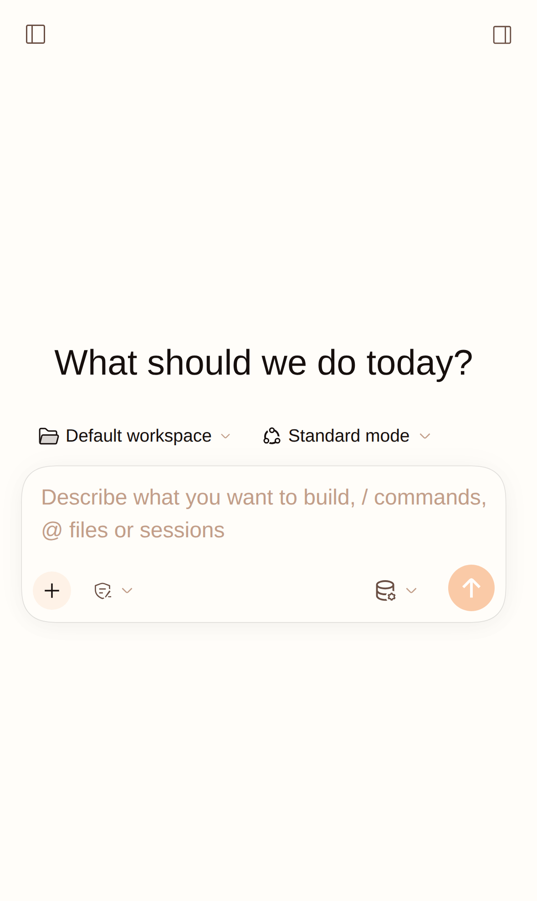
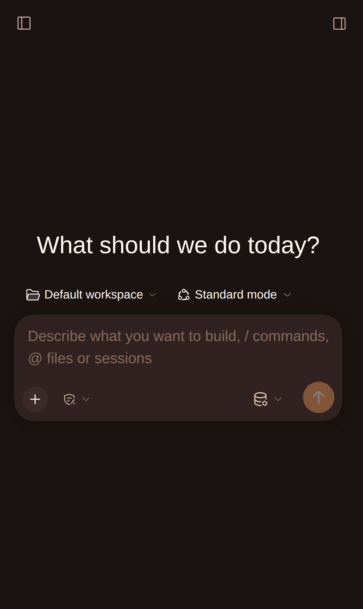
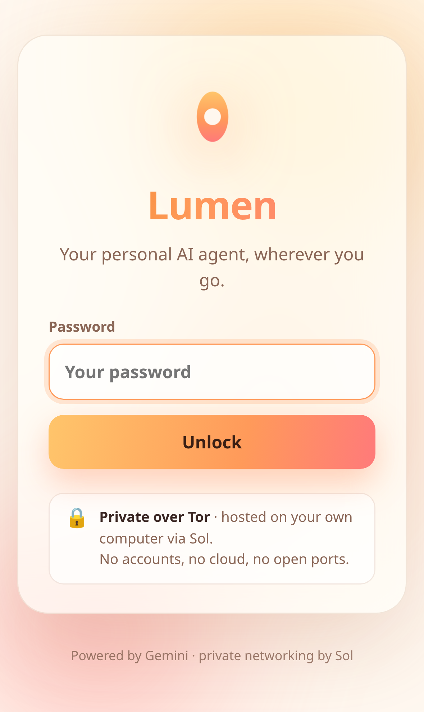

<p align="center"></p>

<h1 align="center">Lumen</h1>
<p align="center"><b>Your personal AI agent, wherever you go.</b><br>
Runs on your own computer. Reachable from your phone or laptop, privately over Tor. No cloud, no accounts, no open ports.</p>

<p align="center">
  
  
</p>

---

Lumen puts a password-protected, sunny new face on an open-source coding and assistant agent and
publishes it with [**Sol**](https://github.com/apv022/sol), so it's private and reachable from anywhere.

```
phone / laptop ──Tor──> your .onion (Sol) ──> Lumen gate (password) ──> agent on your computer ──> Gemini
```

- **Your machine, your files.** The agent runs where your stuff is. It can read files, run commands
  (with approval), search the web, and remember things across sessions.
- **Private by default.** Sol publishes it as a Tor onion service, so your IP stays hidden and no ports are opened.
  The Lumen gate adds a password, login rate limiting, and cross-site protection on top.
- **Secrets stay home.** The Gemini key and the agent's own credentials never leave the machine;
  the browser only gets a Lumen session cookie.
- **Looks like Lumen.** Warm, bright, peachy theme with a cocoa dark mode, its own logo, and it installs to the home screen.

## Screenshots

| Doing real work | Login |
|---|---|
|  |  |

| Phone (light) | Phone (dark) | Phone login |
|---|---|---|
|  |  |  |

## Setup (on the computer that runs Sol)

Needs Go 1.24+, Node 24.9+, and a running [Sol](https://github.com/apv022/sol) node.

```sh
go install github.com/apv022/lumen/cmd/lumen@latest
lumen setup      # choose a password, paste your Gemini API key
lumen            # starts on 127.0.0.1:7777 (first run downloads the agent)
```

Then in the Sol panel (`http://127.0.0.1:8080`) add a service with **port 7777**:

| You want to reach it from | Sol visibility |
|---|---|
| Your paired laptops (`sol connect`) | Only my devices |
| Your phone, in Tor Browser | Anyone with Tor Browser (the Lumen password protects it) |

**Phone on your tailnet, without Tor Browser:** on a paired laptop run
`sol connect -L lumen=$(tailscale ip -4):9000`, then open `http://<laptop's tailscale IP>:9000` on the phone.
The phone reaches the laptop over WireGuard, and the laptop reaches your computer over Tor.

In the agent's **Settings → Models**, pick the Google provider. The key from `lumen setup` is already
in its environment.

## How it works

`lumen` starts the agent bound to a random loopback port, completes the agent's launch-token login
itself, and puts a reverse proxy in front of it:

- **Sign-in:** every request needs a Lumen session (a PBKDF2-hashed password and a 30-day `HttpOnly` cookie).
  Failed logins are rate-limited globally, because behind Tor every client looks alike.
- **Cross-site protection:** browser `Sec-Fetch-Site` / `Origin` checks block cross-site requests and WebSockets.
- **Credential isolation:** the agent's own cookie is attached on the server and never sent to the browser.
- **Theming:** HTML pages get the Lumen theme injected, with content-hashed URLs so updates reach browsers immediately. It's a CSS palette override of the agent's
  design tokens plus a small renaming script, and the agent's code is unmodified.

Run the tests with `go test ./...`.

## Credits

The agent is [DeepSeek Harness](https://github.com/deepseek-ai/deepseek-harness) (MIT), downloaded
from npm and run unmodified. Lumen is an independent project, not affiliated with or endorsed by
DeepSeek. The models are from Google Gemini, and the networking is [Sol](https://github.com/apv022/sol).

Licensed under [Apache-2.0](LICENSE).

## Troubleshooting

- **Shell commands fail with `sandbox: file access denied`:** the agent's sandbox only allows writes
  in its workspace folder. Open your project as the workspace, or pick a wider mode in the
  permissions menu under the chat box for that session.
- **Still see the old look after updating:** reload the page once.
